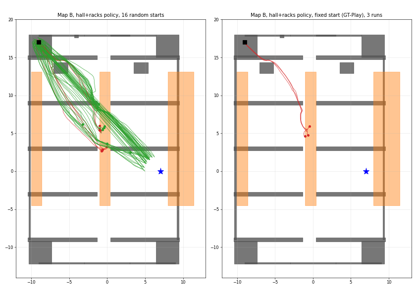

# Spot Visual SLAM (Isaac Lab 3.0)

[](https://isaac-sim.github.io/IsaacLab)
[](https://docs.python.org/3/whatsnew/3.12.html)
[](https://releases.ubuntu.com/)
[](https://docs.ros.org/en/jazzy/)

**Spot Visual SLAM** studies what happens to a learned quadruped navigation policy when the robot's pose comes from a
visual SLAM system instead of the simulator. It runs on the Boston Dynamics Spot in [Isaac Lab](https://isaac-sim.github.io/IsaacLab)
3.0 and reproduces, then extends, *System-Level Performance Analysis of Visual SLAM and Reinforcement Learning
Integration for Quadruped Navigation* (Li & Jeong, IJCAS 2026, `references/main.pdf`).

The system has two policies and one pose source:

```
goal (known exactly)        depth image 80x60
        |                          |
        v                          v
 high-level policy  --(vx, wz)-->  low-level policy  -->  12 joint targets  -->  Spot
 (9-dim obs, MLP)                  (353-dim obs, frozen)
        ^
        |  pose x, y, yaw
 pose source:  ground truth  |  cuVSLAM (in process)  |  ORB-SLAM3 (ROS 2)
```

## Key Features

- **Two-level navigation.** A frozen low-level locomotion policy (walks at a commanded velocity, sees depth ahead) under
  a high-level policy that reaches a goal on the paper's Map A and Map B.
- **Three pose sources, one policy.** Ground truth, cuVSLAM stereo (one tracker per environment, so training runs with
  SLAM in the loop), and ORB-SLAM3 RGB-D or stereo over ROS 2. The pose is the only observation that is swapped.
- **Paper evaluation protocol.** `scripts/tools/eval_nav_protocol.py` runs Table 9 (3000 steps, collisions counted,
  success = goal radius), with random starts and SLAM pose error against ground truth.
- **Tracking-quality inputs.** Quality signals from cuVSLAM (feature count, odometry vs loop-closure gap) are measured
  against pose error and can be fed to the policy (condition C below).
- **Procedural training worlds.** Random mazes and halls with doorways, shelves and open racks, built from terrain
  tiles, so Maps A and B are never trained on.
- **A frozen baseline.** The earlier `rl_vslam_v0` policy set stays reproducible (git tag `baseline/rl-vslam-v0`).

## Getting Started

### Installation

1. Install Isaac Lab 3.0 (this machine: `~/IsaacLab`) and the Isaac Sim asset pack (`ISAACSIM_ASSET_ROOT`).
2. Install this package: `uv sync` (or `~/IsaacLab/isaaclab.sh -p -m pip install -e source/spot_vslam`).
3. For ORB-SLAM3 and Nav2 only: `source /opt/ros/jazzy/setup.bash` and build the ORB-SLAM3 ROS 2 nodes in `source/spot_vslam/ros2` (see `scripts/README.md`).
   cuVSLAM and ground truth need no ROS 2.

### Run

Every high-level run needs the frozen low level:

```bash
export SPOT_VSLAM_LOW_LEVEL_CKPT=policies/walls_soft_mirror_turn/model.pth

# Watch a trained high level in a window (ground-truth pose)
uv run --no-sync python scripts/rl_games/play.py --task Spot-Nav-MapA-GT-Play-v0 --cameras \
  --checkpoint policies/nav_hall_racks/model.pth --viz kit

# Paper Table 9 on Map B with cuVSLAM, random starts
uv run --no-sync python scripts/tools/eval_nav_protocol.py --task Spot-Nav-MapB-cuVSLAM-Play-v0 \
  --checkpoint policies/nav_hall_racks/model.pth --num_envs 8 --jitter_xy 0.5 --jitter_yaw 0.5
```

Isaac Lab 3.0 runs headless by default; add `--viz kit` for a window and pass `--cameras` to `train.py`. Only one Isaac
Sim fits on a 15 GB machine at a time. All commands for training, evaluation and SLAM tests are in
[`scripts/RUN_COMMANDS.txt`](scripts/RUN_COMMANDS.txt); more in [`scripts/README.md`](scripts/README.md).

### Documentation

| File | Content |
| --- | --- |
| [`docs/SYSTEM.md`](docs/SYSTEM.md) | System diagram, each policy's inputs and outputs |
| [`docs/ROADMAP.md`](docs/ROADMAP.md) | Run history, what to fix and build next |
| [`docs/DESIGN_DECISIONS.md`](docs/DESIGN_DECISIONS.md) | Why each choice was made, and what is only a guess |
| [`docs/PAPER_OUTLINE.md`](docs/PAPER_OUTLINE.md) | Follow-up paper outline with all measured tables |
| [`docs/low_level_reward.md`](docs/low_level_reward.md) | Low-level reward, PPO settings, gait fixes (mirror loss) |
| [`docs/cuvslam.md`](docs/cuvslam.md) | cuVSLAM setup, frames, accuracy against ground truth |
| [`references/README.md`](references/README.md) | Paper settings and where they live in the code |
| [`policies/README.md`](policies/README.md) | Trained checkpoints, source runs, SHA-256 |

## Tasks

| Task ID | What |
| --- | --- |
| `Spot-Paper-v0`, `Spot-Paper-Walls{,Soft,SoftMirror,SoftMirrorTurn}-v0` | Low level (353-dim obs); the one used is `WallsSoftMirrorTurn` |
| `Spot-Nav-HallRacks-v0` | High level, condition A: ground-truth pose, halls with open racks |
| `Spot-Nav-HallRacks-cuVSLAM-v0` | Condition B: cuVSLAM pose in training |
| `Spot-Nav-HallRacks-cuVSLAM-Quality-v0` | Condition C: cuVSLAM pose plus 3 quality inputs (12-dim) |
| `Spot-Nav-Map{A,B}-GT-Play-v0` / `-cuVSLAM-Play-v0` / `-Play-v0` / `-Stereo-Play-v0` | Evaluation on Map A or B with GT, cuVSLAM, ORB-SLAM3 RGB-D, ORB-SLAM3 stereo |
| `Spot-Nav-Map{A,B}-cuVSLAM-Quality-Play-v0` | Evaluation of condition C |
| `Spot-Nav-Maze-v0`, `Spot-Nav-Hall-v0` | Earlier high-level training worlds |
| `Spot-Vslam-*`, `Spot-Paper-high-level-*` | `rl_vslam_v0` baseline and the SB3 high level |
| `Spot-test180-v0` | SLAM test env |

Task ids of trained policies never change. Config files are under `source/spot_vslam/spot_vslam/tasks/`.

## Results so far

Success rate on the paper maps, random start (+-0.5 m, +-0.5 rad), cuVSLAM pose, 3000 steps. All are trained 1300
epochs from the same checkpoint (`nav_hall_racks`, epoch 7500). A uses the ground-truth pose; B uses the cuVSLAM
pose; C uses the cuVSLAM pose plus tracking-quality inputs. B and C have two training seeds, A has one.

| Policy | Map A | Map B |
| --- | --- | --- |
| A: GT pose in training (control, seed 2) | 20/24 | 19/24 (79 %) |
| B: cuVSLAM pose | 54/56 | 9/56 (28 % and 0 % per seed) |
| C: + quality inputs | 53/56 | 25/48 (50 % and 54 % per seed) |

C recovers much of what B loses, but stays below the GT-trained policy. Map B is limited by an open rack that every
policy bumps into. Runs of one policy are not independent; the unit for a claim is the training seed. Full tables and
caveats: [`docs/PAPER_OUTLINE.md`](docs/PAPER_OUTLINE.md).



## Repository layout

```
docs/              system, roadmap, design decisions, paper outline, measurements
scripts/           rl_games/ (train, play), tools/ (evaluation, analysis), slam/ (SLAM tests), high_level/ (SB3), legacy/
policies/          final checkpoints with their yaml and SHA-256
baselines/         frozen rl_vslam_v0 policies and results
references/        the paper, its bibliography, paper-vs-code notes
output/ logs/      git-ignored run outputs and training logs
source/spot_vslam/
  ros2/            ORB-SLAM3 RGB-D and stereo wrappers (C++), launch/ for Nav2
  spot_vslam/
    assets/        USD paths, Spot config, paper maps
    envs/          ManagerBasedRLEnv with optional ROS 2 / ORB-SLAM3 / cuVSLAM managers
    slam/          Ros2Manager, OrbSlamSubscriberManager, CuVslamManager, DenseMapManager (TSDF)
    tasks/         locomotion/, navigation/, slam_test/  (<task>_env_cfg.py, mdp/, config/spot/)
    legacy/        SB3 high-level wrappers
```

## Troubleshooting

- **cuVSLAM loses the pose** in plain grey worlds: the training worlds of conditions B and C use a marble tile
  texture for that reason (median pose error 8.8 m without, 0.23 m with).
- **Depth-only camera blacks out RGB** in Isaac Lab 3.0: give the policy camera an RGB data type when an RGB camera is
  in the scene.
- **Out of memory** with 16 cuVSLAM envs on a 15 GB machine: use `--num_envs 8` for evaluation and close other apps.
- **`events = None` or `rewards = None`** on an env config crashes `sim.reset()`: use an empty configclass.
- More notes: `CLAUDE.md` ("Isaac Lab 3.0 migration notes") and `docs/ROADMAP.md`.

## Development

```bash
uvx ruff check source scripts
pre-commit run --all-files
```

There is no test suite. Verification means loading the task configs and running a short headless episode.

## License

No license file has been added to this repository yet. Isaac Lab is released under the BSD-3 license, and full-featured
workflows (PhysX, RTX rendering, ROS) require [Isaac Sim](https://docs.isaacsim.omniverse.nvidia.com/latest/index.html),
which has its own license terms.

## Citation

This work builds on the paper below and on Isaac Lab:

```
@article{li2026systemlevel,
  author  = {You-Hao Li and Jaesik Jeong},
  title   = {System-Level Performance Analysis of Visual {SLAM} and Reinforcement Learning Integration for Quadruped Navigation},
  journal = {International Journal of Control, Automation, and Systems},
  year    = {2026}
}

@article{mittal2025isaaclab,
  title   = {Isaac Lab: A GPU-Accelerated Simulation Framework for Multi-Modal Robot Learning},
  author  = {Mayank Mittal and others},
  journal = {arXiv preprint arXiv:2511.04831},
  year    = {2025}
}
```

## Acknowledgement

The original author code of the paper (github.com/BernieMHao/slam_project) has no USD files; the robot is the stock
Isaac Sim Spot and the maps come from the Isaac Sim `Simple_Warehouse` assets. The mirror loss follows Mittal et al.,
*Symmetry Considerations for Learning Task Symmetric Robot Policies* (ICRA 2024). SLAM comes from
[ORB-SLAM3](https://github.com/UZ-SLAMLab/ORB_SLAM3) and NVIDIA cuVSLAM.
