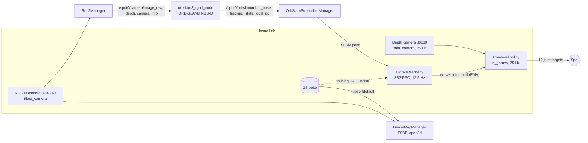

# System overview

How the parts connect, and what each policy reads and outputs. Paper: `references/main.pdf`.

## Policies

| | Low level | High level `rl_vslam_v0` | High level (paper) |
| --- | --- | --- | --- |
| Task | `Spot-Paper-v0` (paper), `Spot-Vslam-Depth-v0` (v0) | `Spot-Vslam-high-level-*` | `Spot-Paper-high-level-Map{A,B}-*` |
| Code | `tasks/spot_vslam/paper_cfg.py` | `high_level/high_level_vec_env.py` | `high_level/paper_vec_env.py` |
| Input | 353 dims (paper) / 245 (v0): pooled depth, 5 depth stats, base vel, gravity, command, joints, last action | 11 dims: SLAM x, y, yaw, ORB tracking state, 5 depth stats, last action (2) | 9 dims: SLAM x, y, yaw, goal dx, dy, heading error, base vx, vy, wz |
| Output | 12 joint position targets | vx, wz | vx ∈ [0, 1] m/s, wz ∈ [−0.4, 0.4] rad/s |
| Goal | — | none | fixed start and goal per map (`PAPER_MAPS`) |
| Net | [512, 256, 128] ELU | SB3 default [64, 64] | [256, 128] ELU |

- The paper high level is **trained without SLAM**: its "SLAM pose" is the GT pose in the start-pose frame plus small
  noise (`fake_slam_noise_std`). ORB-SLAM3 is used only at play/test time.
- **TSDF only builds a map.** `DenseMapManager` is created only in `scripts/high_level/load_high_level.py`; nothing
  from it goes into any observation. Its pose is GT by default (`--dense_pose_source gt`) or ORB-SLAM3.
- Timing: sim dt 0.002 s, low-level decimation 20 (25 Hz), high-level decimation 2 (12.5 Hz), command EMA α = 0.25.

## Where to measure latency

1. Image render time in Isaac Lab (sim step that produced the image).
2. `Ros2Manager` publishes the image (stamp it here).
3. `orbslam3_rgbd_node` receives it, `TrackRGBD` returns (SLAM processing time).
4. Pose message arrives in `OrbSlamSubscriberManager`.
5. The high level reads the pose in `_get_obs_tensor`.

End-to-end delay = 5 − 1. SLAM processing time = inside 3.
