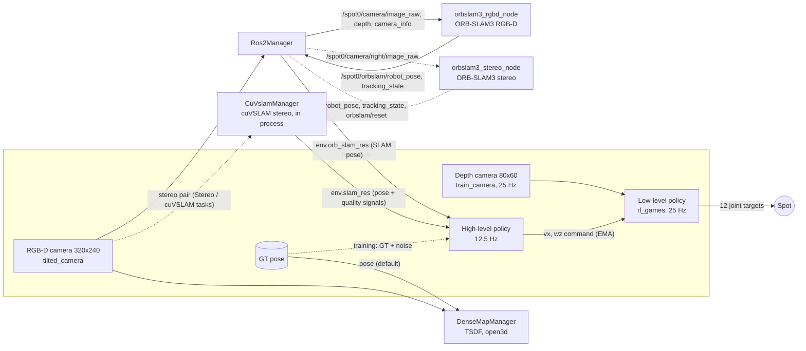

# System overview

How the parts connect, and what each policy reads and outputs. Paper: `references/main.pdf`. Code paths are under
`source/spot_vslam/spot_vslam/`.

## Policies

| | Low level | High level (paper) |
| --- | --- | --- |
| Task | `Spot-Paper-v0` | `Spot-Nav-Map{A,B}-*` (manager-based); SB3: `Spot-Paper-high-level-*` |
| Code | `tasks/locomotion/` | `tasks/navigation/`; SB3: `legacy/high_level/paper_vec_env.py` |
| Input | 353 dims: base lin/ang vel, gravity, joint pos/vel, last action, velocity command, pooled depth, 5 depth stats | 9 dims: pose x, y, yaw (start frame), goal dx, dy, goal heading error, base vx, vy, wz |
| Output | 12 joint position targets | vx ∈ [0, 1] m/s, wz ∈ [−0.4, 0.4] rad/s |
| Goal | — | fixed start and goal per map (`assets/maps.py`) |
| Net | [512, 256, 128] ELU | [256, 128] ELU 
- **The low level reads no real sensors except depth.** Base lin/ang vel, gravity and joint pos/vel come straight
  from the simulator state (as in the original code and Isaac Lab's Spot): no `Imu` sensor, no encoder model (delay,
  resolution, bias, drift). Noise: uniform only (lin/ang vel ±0.1, gravity ±0.05, joint pos ±0.05, joint vel ±0.5;
  in `Spot-Paper-WallsSoftNoise-v0`). Joint pos/vel are close to a real Spot's encoders; base lin
  vel is the furthest from real (an IMU cannot give it; a real robot estimates it from IMU + leg odometry).
- **The high level is trained without SLAM**: its pose is the GT pose in the start-pose frame plus small noise
  (condition A). ORB-SLAM3 is used only when evaluating (`Spot-Nav-*-Play-v0`). The pose source is one observation
  parameter (`pose_source="gt" | "slam"`), so conditions B/C are config changes.
- In `Spot-Nav-*` the frozen low level runs inside the action term `tasks/navigation/mdp/actions.py`
  (`LowLevelPolicyAction`), which loads the rl_games `.pth` from `$SPOT_VSLAM_LOW_LEVEL_CKPT`.
- **TSDF only builds a map.** `DenseMapManager` (`slam/dense_map.py`) is created only in
  `scripts/high_level/load_high_level.py`; nothing from it goes into any observation. Its pose is GT
  (`--dense_pose_source gt`) or ORB-SLAM3.
- Timing: sim dt 0.002 s, low-level decimation 20 (25 Hz), high-level decimation 2 (12.5 Hz), command EMA α = 0.25.
  `Ros2Manager` publishes images and reads back SLAM poses once per env step, right before the observations.

## Where to measure latency

1. Image render time in Isaac Lab (sim step that produced the image).
2. `Ros2Manager` publishes the image (stamp it here).
3. `orbslam3_rgbd_node` receives it, `TrackRGBD` returns (SLAM processing time).
4. Pose message arrives back in `Ros2Manager` (`env.orb_slam_res`).
5. The high level reads the pose (`tasks/navigation/mdp/observations.py: robot_pose`).

End-to-end delay = 5 − 1. SLAM processing time = inside 3.
